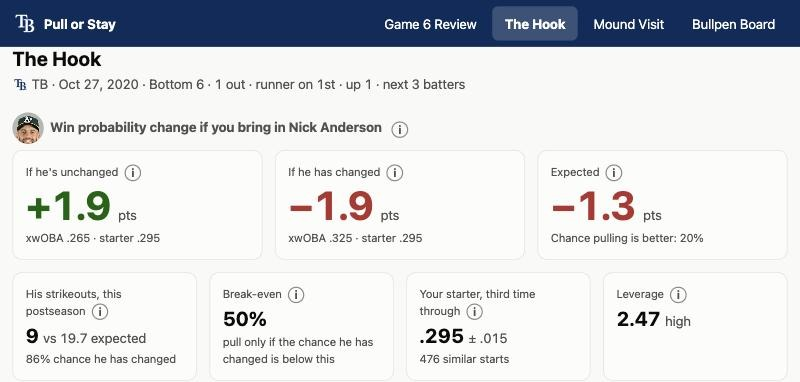
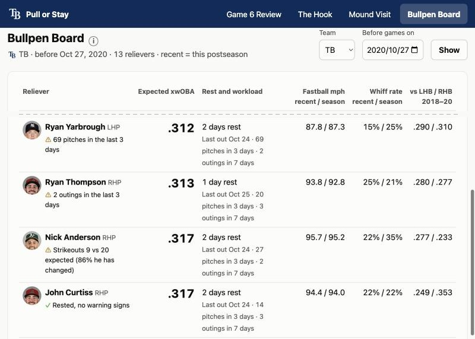

# Pull or Stay

A decision tool for a baseball coaching staff: **should the starting pitcher stay in, or go to the bullpen?**
It is built around one famous call: Kevin Cash pulling Blake Snell in Game 6 of the 2020 World Series.

**Live site:** https://baseballwebsite-inky.vercel.app


## The question

Bottom of the 6th, Rays up 1–0, one out, runner on first. Snell had 9 strikeouts on 73 pitches. Next up were
Mookie Betts, Corey Seager and Justin Turner, each about to face him for the third time. Cash brought in Nick Anderson,
the Dodgers scored twice that inning and won the Series.

The pull is usually judged by what happened next. This project asks a different question: **using only what the
coaching staff could have known before the pitch, what was the decision worth?** The site turns the same analysis into
tools a manager, pitching coach and bullpen coach could use for any game from 2018–2020.

## The site

Each page puts its key numbers first. Explanations sit behind ⓘ tips so coaches can read the data and draw their own conclusions.

| Page | Built for | What it shows |
|---|---|---|
| **Game 6 Review** | everyone | Rays win probability batter by batter, the numbers around the pull, and the other three pages' view of that moment |
| **The Hook** | manager | Win-probability change from pulling the starter if the reliever is unchanged, if he has changed, and the expected value. Any team, date, reliever and game situation. Lists the data each input uses |
| **Mound Visit** | pitching coach | Today's starter vs. his season (velocity, spin, whiff rate, strikeouts, xwOBA) and how starts like this go the third time through |
| **Bullpen Board** | bullpen coach | Every recent reliever, sorted by projected xwOBA, with rest, workload, velocity drops and a strikeout warning when he may have changed |

<p>
  
  
</p>

## What the data says about Game 6

- **Snell's stuff was real.** His four-seam fastball averaged 96.3 mph (95.0 in the 2020 regular season) and hitters missed on
  46% of their swings (32% in the season). Through 73 pitches: 18 batters, 9 K, 2 H, 0 BB.
- **Dominant starts partly regress.** 476 regular-season starts (by 158 pitchers) were about as dominant through two times through
  the order. Those starts allowed a .182 xwOBA through two times and **.295 ± .015** the third time. All 8,079 starts: .306, then .336.
  Picking starts that were dominant early also picks some luck, so the third time looks closer to average.
- **Anderson's strikeouts had disappeared.** His velocity held (95.7 mph in the postseason vs. 95.2), but he struck out
  **9 of 57** postseason hitters. Against those hitters, who strike out less than average, his history predicted **19.7**
  (2.8 standard deviations more than he got). That moves the chance his talent had changed from a 10% starting point to **86%**.
- **Value of the pull over the next three batters** (leverage 2.47):

  | If Anderson is… | His projected xwOBA | Win-probability change from pulling |
  |---|---|---|
  | unchanged (all his games) | .265 ± .025 | **+1.9 points** |
  | changed (postseason only) | .325 ± .039 | **−1.9 points** |
  | expected (86% changed) | | **−1.3 points** |

  Pulling comes out ahead only if the chance he has changed is below **50%**. The chance pulling was better, counting the
  uncertainty in both pitchers' numbers: **20%**.
- **What actually happened:** the Rays' win probability went from 60% to 31% over those three batters. One inning is far noisier
  than the estimate: the wOBA of three batters has a spread of about .30, against ± .015 for the starter's number. That is
  why the decision is judged before the pitch, not after.

## How the answer changed after review

A review in November 2026 challenged the first version. Each fix is reproduced by `analysis/game6_checks.py`:

| Version | Pulling Snell, win-probability points | What changed |
|---|---|---|
| First site | +1.8 / +0.8 / −4.6 for three versions of Anderson; "pull if at least 72% sure he's at full strength" | |
| Starter in xwOBA too | +0.8 / −0.2 / −5.6; pull if at least 87% sure | The starter used actual wOBA, the reliever expected wOBA. Using the same measure on both sides moved the middle case from + to − |
| Each component with its own constant | +1.8 if unchanged, −2.2 if changed | One constant (300) for overall xwOBA was replaced by separate constants estimated from the data |
| Change test on strikeouts | 98% changed, expected −2.2 | "How sure are you?" is now estimated from his strikeouts instead of asked |
| Adjusted for the hitters he faced (current site) | 86% changed, expected **−1.3** | Postseason hitters strike out less, which explains part of the drop |

The 72% in the first version was never the chance Anderson was healthy. It was the weight between two scenario endpoints,
and the data never measured how he felt that night. The current version replaces it with a probability estimated from his
strikeouts and checked against two seasons of relievers.

## How it's built

```
Statcast (pybaseball) ──► build_database.py ──► data/warehouse.db ──► 10 checks ──► site_data/coaches.db ──► Flask site (Vercel)
 1,739,940 pitches          SQL tables:            SQLite, 346 MB                     12.6 MB, read-only        model.py
 2018–2020 regular seasons   plate appearances,
 + 2020 postseason           starts, pitcher games,
                             splits, leverage
```

**Data.** Every pitch from the 2018–2020 regular seasons and the 2020 postseason, from Baseball Savant via `pybaseball`,
loaded into SQLite. Plate-appearance and game tables are built in SQL. For example, times through the order is
`ROW_NUMBER() OVER (PARTITION BY game_pk, pitcher, batter ORDER BY at_bat_number)`.

Both pitchers are measured in **expected wOBA (xwOBA)** using only games before the date (`model.py`).

**Starter, third time through.** Earlier regular-season starts about as dominant through two times through the order
(strikeout rate no more than 15 points lower, wOBA no more than .100 higher, no more than 12 extra pitches), and the xwOBA
hitters posted the third time through. The ± is a 95% range for the average with standard errors clustered by pitcher,
because the same pitchers appear in many starts.

| Comparable starts | Starts | Reached a third time | Faced 3+ batters | Times 1–2 xwOBA | Time 3 xwOBA |
|---|---|---|---|---|---|
| About as dominant as Snell | 476 | 468 (98.3%) | 433 (91.0%) | .182 | .295 |
| All starts with 18+ batters | 8,079 | 7,739 (95.8%) | 6,809 (84.3%) | .306 | .336 |

Only starts the manager let continue show a third time, but 98% of these did, so that filter removes little. Its direction is
unclear: managers pull pitchers who look worse, but the outings that ended with a pull keep the plate appearances before it.

**Reliever.** Strikeout rate, walk rate and contact quality become reliable at very different sample sizes, so each is pulled
toward the league average separately and then recombined:

```
shrunk rate = (his events + league rate × K) / (his chances + K)
xwOBA       = walk rate × 0.69 + (1 − strikeout rate − walk rate) × xwOBA on the other plate appearances
```

K comes from split-half reliability (`analysis/estimate_regression_constants.py`): split each reliever-season's games into two
halves, correlate the halves across pitchers (r), and K = m × (1 − r) / r for halves of m plate appearances.

| Component | r with halves of 60 PA | K used |
|---|---|---|
| Strikeout rate | .50 | 60 plate appearances |
| Walk rate | .31 | 130 plate appearances |
| xwOBA on other plate appearances | .07 | 600 (large and uncertain: contact quality barely repeats within a season) |
| Overall xwOBA (old single constant: 300) | .21 | 175–330, depending on m |

**Has he changed?** Compare his recent strikeouts (this postseason, or the last 30 days) with what his earlier games predict.
In the postseason the prediction is adjusted for the hitters he faced, with each hitter's own strikeout rate against that
pitcher hand and the odds-ratio method:

```
odds(expected) = odds(his usual rate) × odds(hitter's rate) / odds(league rate)
Bayes factor   = P(recent strikeouts | fresh league-average talent) / P(recent strikeouts | his usual talent)
P(changed)     = 10% × BF / (10% × BF + 90%)
```

"Unchanged" uses all his games; "changed" uses only the recent ones; "expected" weights the two by P(changed).

**Win value of the pull.**
`points = batters × (starter xwOBA − reliever xwOBA) ÷ 1.2 × leverage ÷ 10 × 100`.
The difference becomes runs (÷ 1.2 wOBA scale), runs become wins (÷ 10 runs per win), scaled by how much this moment matters.
Three batters, because since 2020 a reliever must face at least three (or finish the inning).
**Leverage index:** the average absolute change in win probability for plate appearances in the same inning, half, outs, bases and
score margin (2018–2020 regular seasons), divided by the average for all plate appearances.

### Backtest of the change test

`analysis/backtest_reliever_change.py` puts a decision point before every relief appearance in the 2019–2020 regular seasons,
uses the reliever's last 50+ plate appearances as "recent", and predicts his next 50+. 2019 (5,743 points, 243 pitchers) chose the
10% prior; 2020 (94 points, 33 pitchers) is the out-of-sample test.

- In 2020, the change-aware prediction of strikeouts beat the unchanged one in 100% of bootstrap samples by pitcher
  (small gain: 0.001 to 0.007 log-loss per plate appearance). In 2019 the gain was tiny.
- Big recent swings carry forward:

  | Recent strikeouts vs. expected | Points (pitchers) | Next 50 PA: predicted K%, unchanged | Actual | Predicted xwOBA, unchanged | Actual |
  |---|---|---|---|---|---|
  | 2–3 standard deviations below | 143 (40) | .230 | .221 | .306 | .318 |
  | within 2 | 5,409 (246) | .254 | .256 | .298 | .302 |
  | 2+ above | 284 (60) | .271 | .292 | .291 | .280 |

- **Only one regular-season stretch in 2019–2020 fell more than 3 standard deviations below expectation**, so the backtest
  confirms the direction but not the size of an Anderson-level drop.

### Sensitivity

27 starter filters × 4 priors × 3 contact constants (`analysis/game6_checks.py`):

| Prior chance of a change | Expected value of pulling | Settings where pulling is better | Chance pulling is better |
|---|---|---|---|
| 2% | −1.4 to +1.0 | 35 of 81 | 32–60% |
| 5% | −2.2 to +0.2 | 9 of 81 | 19–44% |
| **10% (chosen by the backtest)** | **−2.7 to −0.3** | **0 of 81** | 11–35% |
| 20% | −2.9 to −0.6 | 0 of 81 | 7–30% |

The conclusion leans on the prior. With the prior the backtest chose, staying was better in every setting. With a very skeptical
prior it is a coin flip.

### Data used for each input (Game 6)

The Hook lists these for any date. Everything for Game 6 comes from games before it.

| Input | Data used |
|---|---|
| Starter: comparable starts | regular-season starts through Sep 26, 2020 |
| Reliever: history | regular-season games, Mar 28, 2019 to Sep 25, 2020 (318 PA) |
| Reliever: recent | 2020 postseason, 9 games through Oct 24 (57 PA; Game 6 not included) |
| League averages | 2019–2020 regular-season games before Oct 27, 2020 |
| Hitters' strikeout rates | 2018–2020 regular seasons (all before the postseason) |
| Leverage | 2018–2020 regular seasons |

### Data checks

`build_database.py` runs these before exporting anything. All 10 pass.

| Check | Result |
|---|---|
| Each pitch appears once | 0 duplicates |
| Each plate appearance has one result | pass |
| Every game has two starters | pass |
| Regular-season games complete | all three seasons |
| Times through the order is between 1 and 4 | 0 bad rows |
| Exit velocity recorded on balls in play | ≥ 97% |
| Leverage index averages 1.0 | pass |
| Snell's Game 6 matches the box score | 73 pitches / 18 BF / 9 K / 2 H / 0 BB |
| Win probability chains from one plate appearance to the next | mean gap 0.0001 |
| SQL tables reproduce the pandas analysis | 8,079 starts / .349 and 476 starts / .311 (wOBA) |

## Limitations

- **The decision is still a rule of thumb.** Runs and wins come from fixed conversions (÷ 1.2, ÷ 10) and a fixed three batters at
  the starting leverage. Staying also keeps an option that pulling gives up: Snell could face Betts and the staff could decide again,
  while Anderson must face three batters or finish the inning. That option isn't valued yet.
- **Average hitters.** The Hook estimates against average hitters. Who is due up is not included; a handedness-only version
  (`snell_matchups.py`, first version) moved the answer by about 0.1 point.
- **The prior.** The backtest's log loss barely changes between priors in 2019, so 10% is a reasonable choice, not a precise one.
- **The test uses strikeouts only.** Anderson's whiff rate also fell (35% to 22%), which isn't used. "Changed" means a fresh draw
  from the league's reliever talent, one choice among several.
- **Not everything is limited by date yet.** Handedness splits, leverage and the regression constants use all of 2018–2020. For
  Game 6 that is all earlier data; for an earlier date, those inputs include later games. The Hook marks leverage in its data
  list, and the Bullpen Board's ⓘ notes it for the splits.
- **Data ends in 2020.** Three seasons give only one Anderson-level stretch to test against, and the 2023 rule changes
  (pitch clock, shift limits) changed the run environment.
- **Player photos are current.** MLB serves each player's current headshot, so some appear in a later team's cap.

## Next steps

1. **Game-state simulation.** Outcome probabilities for each pitcher against each hitter (odds-ratio method), a Markov chain over
   base-out states, and win probability by game state. Compare three strategies: pull now, let Snell face Betts and decide again,
   let Snell face all three. This replaces the fixed conversions and values the option of deciding later.
2. **2021–2025 data.** A bigger backtest for extreme strikeout drops, and date-limited splits and leverage.
3. **Matchup matrix.** The next hitters vs. each available pitcher by handedness, zone and pitch type.

## Run it yourself

The site only needs the small database that's already in the repo:

```bash
python3 -m pip install -r requirements.txt
python3 app.py            # then open http://127.0.0.1:5001
```

The analysis scripts also run on that database (standard library only):

```bash
python3 analysis/estimate_regression_constants.py   # split-half reliability -> regression constants
python3 analysis/backtest_reliever_change.py        # the change test, 2019 -> 2020
python3 analysis/game6_checks.py                    # every Game 6 number in this README
```

To rebuild everything from Statcast (the first run takes a while; later runs read from pybaseball's cache):

```bash
python3 -m pip install pybaseball pandas matplotlib
python3 build_database.py              # warehouse + checks + site_data/coaches.db
python3 build_database.py --skip-load  # rebuild the tables without reloading pitches
```

The first version's analysis scripts, in order: `snell_vs_peers.py` → `snell_decision.py` → `snell_matchups.py`.
They write CSVs and a chart to `output/`. Tested with Python 3.9.

## Project structure

```
app.py               Flask routes for the four pages
model.py             projections, the change test and the pull decision
queries.py           data access: pitcher totals, leverage, the starter card, win probability
charts.py            win-probability chart, drawn as SVG on the server
mlb.py               team colours, logos, headshots and game-film links
templates/           page templates (Jinja)
public/static/       stylesheet (Vercel serves public/ from its CDN)
site_data/           coaches.db and DATA_DICTIONARY.md (every table and column)
analysis/            regression constants, backtest and Game 6 checks
build_database.py    Statcast → SQLite warehouse → checks → site database
snell_*.py           the first version's Game 6 analysis
output/              CSVs and charts from the analysis scripts
docs/                screenshots for this README
```

## Credits

Pitch data: [Baseball Savant](https://baseballsavant.mlb.com) (Statcast) via [pybaseball](https://github.com/jldbc/pybaseball).
Player photos and team logos © MLB, loaded from MLB's servers. Built for the Penn State Sports Analytics Club project cohort.
Time-through-the-order background: Brill, Deshpande & Wyner, "A Bayesian analysis of the time through the order penalty in
baseball" (2023).
